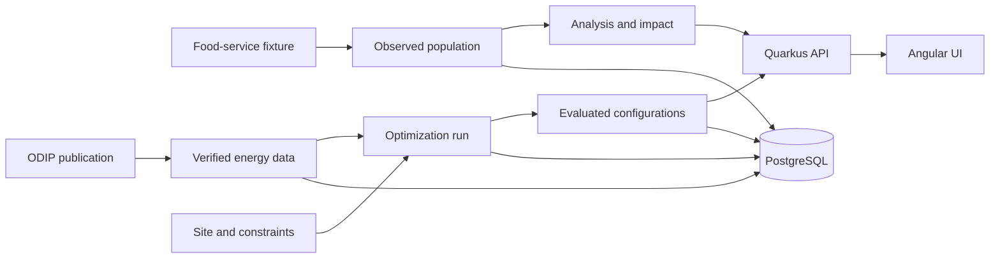

# System Model

This is the engineering model of the implemented Variability Engineering
Framework prototype. It starts with the concepts, then follows them through
runtime execution, HTTP resources, and PostgreSQL storage. It describes the
current implementation; broader framework components are identified where
their absence matters.

| Page | Focus |
|---|---|
| [Conceptual model](conceptual-model.md) | What a population, variant, energy configuration, and optimization run mean. |
| [Runtime model](runtime-model.md) | Service boundaries, data flow, worker lifecycle, and recovery. |
| [API model](api-model.md) | HTTP resources, request and response contracts, ownership, and errors. |
| [Database model](database-model.md) | Flyway tables, keys, relationships, indexes, and stored invariants. |

The prototype has two implemented use cases: analysis of a versioned observed
food-service population and bounded optimization of new energy equipment. They
share a deployment and database, while retaining separate domain types and
storage structures.
