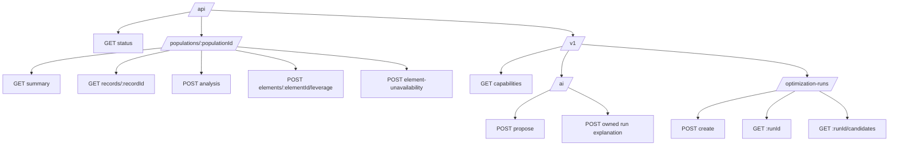

# API Model

All application routes are under `/api`. Population routes expose the
observed food-service population. Energy routes use `/api/v1` and JSON. The
readiness route returns text. HTTP resources project the domain models; the
computation resides in the analysis and energy engines.

## Population analysis

| Method and path | Request and response contract |
|---|---|
| `GET /api/populations/{populationId}` | Population ID/version and artifact provenance, dimension definitions and observed values, aggregate metrics, rejected source records. |
| `GET /api/populations/{populationId}/records/{recordId}` | Population reference and one record's element IDs and dimension values. |
| `POST /api/populations/{populationId}/analysis` | Optional `dimensionFilters`, `requiredElementIds`, and ordered `groupingDimensions`; returns normalized query, selected record IDs, metrics, and group tree. |
| `POST /api/populations/{populationId}/elements/{elementId}/leverage` | Optional analysis `query` and `dimensionIds` (default cuisine and diet); returns matching record count and known values by dimension. |
| `POST /api/populations/{populationId}/element-unavailability` | Analysis `query` plus nonempty `unavailableElementIds`; returns baseline and scenario analyses, lost record/variant/element IDs, root and relative metric deltas, and group deltas. |

A dimension filter can require a value state and include or exclude values.
Metrics contain record count, distinct structural variant count, distinct
element count, element record counts, and element record frequencies. Unknown
population or record IDs yield `404`; invalid query or scenario input yields
`400`.

## Energy optimization

| Method and path | Request and response contract |
|---|---|
| `GET /api/v1/capabilities` | Current search bounds, 300-second timeout, and maximum candidate page size. |
| `POST /api/v1/ai/request-proposals` | `{ "description": "..." }` (at most 4,000 characters; body at most 8 KiB) returns `energy-ai-request-proposal/v1`. A ready proposal contains the complete optimization request; an incomplete description returns clarification questions and a null request. No run is created. |
| `POST /api/v1/ai/optimization-runs/{runId}/explanation` | For an owned, completed run, builds bounded approved evidence and returns a validated `energy-ai-explanation/v1` with exact citations. It accepts no client-selected evidence. |
| `POST /api/v1/optimization-runs` | `energy-optimization-request/v1` body and `Idempotency-Key`; `202` with `runId`, `status: QUEUED`, and `createdAt`. Identical replay returns the original run ID. The acceptance envelope still says `QUEUED` if that run has finished. |
| `GET /api/v1/optimization-runs/{runId}` | `QUEUED`/`RUNNING` status, terminal `energy-optimization-result/v1`, or `FAILED` with error. A terminal result contains dataset digest, model/simulation/optimizer versions, candidate counts, recommendation, warnings, and timestamps. |
| `GET /api/v1/optimization-runs/{runId}/candidates?page=&pageSize=` | Ordered `energy-candidate/v1` items for a `SUCCEEDED` or `INFEASIBLE` run, plus `page`, `pageSize`, and `total`. Defaults are page 0 and size 20; maximum size is 100. |

The optimization request has six top-level fields:

| Field | Shape |
|---|---|
| `schemaVersion` | `energy-optimization-request/v1`. |
| `dataset` | `datasetId`, `version`, `schemaRef`; pins the exact publication. |
| `site` | `regionCode`, `usableRoofAreaM2`, `annualDemandKWh`, `existingComponentIds`. |
| `constraints` | `maxInitialInvestmentEUR`, `minSelfSufficiency`. |
| `objective` | `MIN_ANNUALIZED_COST`. |
| `assumptions` | `analysisYears`, `discountRate`. |

Unknown fields and malformed shapes are rejected. Each candidate contains a
configuration ID, typed components and quantities, feasibility, constraint
evaluations, and metrics. The run response summarizes the optimization;
candidate pages contain per-configuration details.

Energy endpoints require the platform's normalized principal ID, kind,
issuer, subject, and group-ID headers; service principals also need a
client-ID header. The application validates their shape and uses the
principal ID for run ownership. Reads of unknown and unowned runs both return
`404`.

The AI routes are browser-session routes with the same normalized identity
and platform CSRF checks as run creation. The host must include both in the
authenticated energy-route access policy before enabling them. The proposal
route accepts no run ID or arbitrary evidence. The explanation route looks up
only a run owned by the caller and accepts no evidence from the client. Neither
route exposes model tools. The proposal route returns `400` for malformed input
and `413` for an oversized body. The explanation route returns `404` for unknown
or unowned runs, `409` before completion, and `422` if required evidence is
missing or exceeds the limit. Both return `401` for invalid identity, `502` for
invalid model output, and `503` when AI is unavailable. `ENERGY_AI_ENABLED`
defaults to false; the routes
must stay disabled until provider credentials, egress, and hosting policy are
reviewed. The UI requires a separate explicit confirmation of the current
structured request before calling `POST /api/v1/optimization-runs`.

| Status | Energy API meaning |
|---|---|
| `400` | Malformed request, key, run ID, or page. |
| `401` | Missing or malformed normalized principal context. |
| `409` | Reused idempotency key with different input, or candidates not ready. |
| `413` | Request body larger than 64 KiB. |
| `422` | Unsupported model input or requested publication not found. |
| `503` | Publication temporarily unavailable for verification. |

API-generated errors use `error/v1` with `status`, `code`, and `message`.
The hosting platform enforces access and CSRF policy; the application does
not decide role or group membership.

## Readiness

`GET /api/status` returns text and `200` when the persisted food-service
population exists and the energy run table can be queried; otherwise it
returns `503`. Current ODIP availability is outside this check.

Implementation references: [population API](../../../apps/prototype/api/src/main/java/de/eseidinger/variabilityengineering/http/FoodServiceAnalysisResource.java),
[energy API](../../../apps/prototype/api/src/main/java/de/eseidinger/variabilityengineering/http/EnergyOptimizationResource.java).
