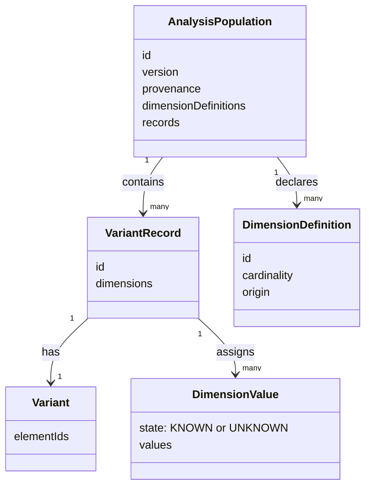
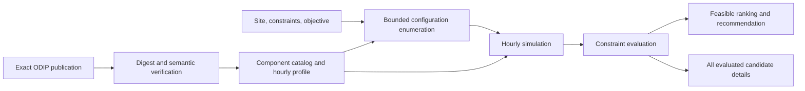

# Conceptual Model

The Variability Engineering Framework studies choices among system variants.
Its longer-term design connects domain models, observations, analysis,
configuration, and optimization through adapters and reusable core semantics.
The current prototype implements two specific slices: observed food-service
analysis and deterministic energy configuration optimization. It does not yet
provide a general model interpreter or portfolio optimizer.

## Observed population and structural variants

An adapter turns versioned source observations into an `AnalysisPopulation`.
Each accepted `VariantRecord` is one observation. Its `Variant` is an unordered
set of element IDs; multiple records can have the same variant. Dimensions
provide attributes used to filter and group observations. A dimension value
can be `KNOWN` with zero or more values, or `UNKNOWN`. A known empty set and
an unknown value have different meanings.

| Concept | Implemented meaning |
|---|---|
| Population | ID and version with artifact provenance, dimension definitions, accepted records, and rejected source records. |
| Record | One accepted source observation with an ID, structural variant, and dimension values. |
| Variant | Element-ID set; distinct variants are counted by set equality, independently of record count. |
| Analysis query | Dimension filters, required elements, and ordered grouping dimensions over a population. |
| Impact scenario | The query result after excluding records containing unavailable elements; the baseline is preserved. |

The food-service fixture adapter verifies a versioned manifest and its source,
mapping, derivation, adapter-contract, and expected-results artifacts. It
normalizes accepted and rejected records and saves the population if absent at
startup. The analysis engine calculates selected records, metrics, and a group
tree from the stored population. The leverage calculation gathers known
dimension values for records using an element. The unavailability calculation
compares the same query before and after affected records are excluded.
Analysis and impact results are computed on request; they are not persisted.

## Generated energy configurations

An energy request identifies one site, constraints, an objective, assumptions,
and an exact dataset publication. The ODIP adapter verifies the publication's
manifest and five artifacts before the model uses them. The energy model
enumerates compatible PV module, inverter, and optional battery combinations.
An hourly simulation calculates energy and economic metrics. The optimizer
checks the investment and self-sufficiency constraints, then ranks feasible
candidates by annualized cost, investment, and configuration ID.

This model supports region `DE-BY-09187182`, objective
`MIN_ANNUALIZED_COST`, 20 analysis years, and a 0.04 discount rate. It accepts
the `existingComponentIds` field in the request shape but rejects nonempty
values. Search limits are 20 catalog models per component type, 100 PV
modules, one inverter, four batteries, and 100,000 candidate evaluations. The
allowed DC/AC ratio is 0.8–1.5.

An observed food-service `Variant` and a generated energy
`EnergyConfiguration` are separate domain types. The former is evidence from
a source record; the latter is a component selection with quantities and
simulation results. There is no common persisted variant or result schema
between these use cases.

## Current boundary of the model

The prototype does not persist a general-purpose generative feature model,
evaluate portable model rules, optimize portfolios, or account for existing
energy equipment. These remain beyond the implemented use cases.
