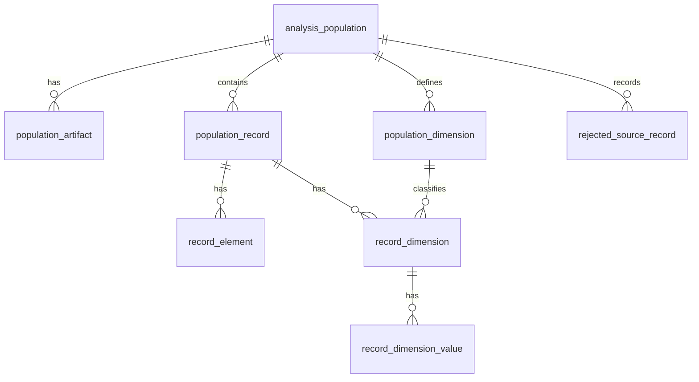
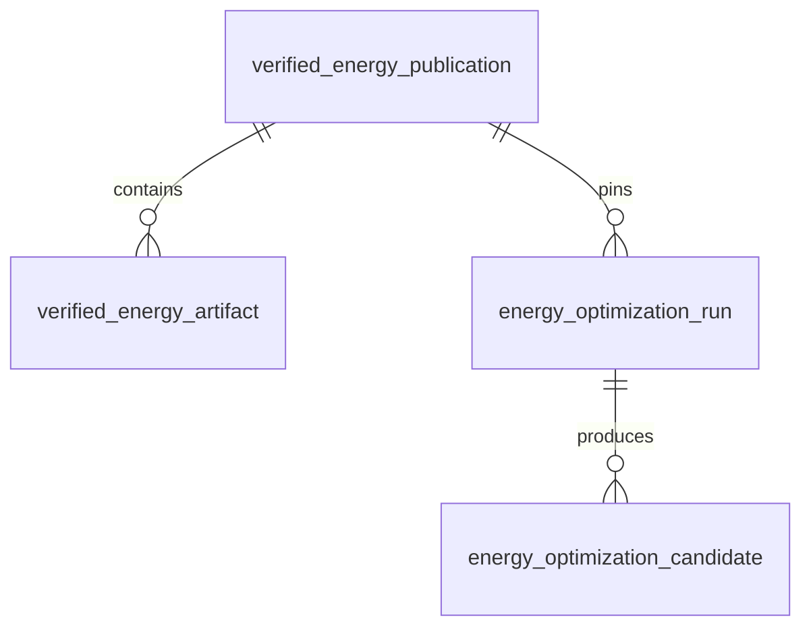
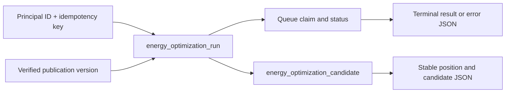

# Database Model

Flyway migrations `V1`, `V2`, and `V3` define three storage areas. Composite
version keys identify imported populations and publications. Food-service
observations are relational; verified energy publications retain source bytes;
energy runs retain JSON request and result projections with candidate rows for
stable pagination.

## Observed populations (`V1`)

| Table | Key and relationship | Stored role |
|---|---|---|
| `analysis_population` | PK `(population_id, population_version)` | Root identity of a normalized population. |
| `population_artifact` | PK population key + `artifact_role`; FK to population | Provenance artifact ID, version, SHA-256. |
| `population_dimension` | PK population key + `dimension_id`; FK to population | Dimension cardinality and origin. |
| `population_record` | PK population key + `record_id`; FK to population | Accepted record identity. |
| `record_element` | PK record key + `element_id`; FK to record | Element membership in the structural variant. |
| `record_dimension` | PK record key + `dimension_id`; FKs to record and dimension | Dimension `value_state` for a record. |
| `record_dimension_value` | PK record/dimension key + `dimension_value`; FK to `record_dimension` | Zero or more values for a known dimension. |
| `rejected_source_record` | PK population key + `source_record_id`; FK to population | Rejection reason and detail. |

Dependent rows have cascading foreign keys. The
`record_element_by_element` index covers `(population_id,
population_version, element_id)`. There is no variant table: each record's
element set is reconstructed, and the analysis engine counts distinct sets.
Repository import behavior provides logical immutability; the schema permits
deletion through its cascading foreign keys. Analysis and impact results have
no tables.

## Verified energy publications (`V2`)

| Table | Key and relationship | Stored role |
|---|---|---|
| `verified_energy_publication` | PK `(dataset_id, publication_version)` | Manifest SHA-256, bytes, optional ETag, and verification time. |
| `verified_energy_artifact` | PK publication key + `artifact_id`; FK to publication with cascade delete | Verified artifact bytes and optional ETag. |

The database limits manifest bytes to 1 MiB and each artifact to 10 MiB. The
ODIP adapter validates five artifacts, their digests and semantics, and the
total publication size. Those semantic checks are application rules, not
database constraints. Cache reads reverify stored bytes. The accepted run
also records the manifest digest so the worker can detect a changed cache.

Transient ODIP transport errors, `429`, or server errors can fall back to a
previously verified exact-version cache entry. Authorization and other client
errors do not permit that fallback.

## Optimization runs (`V3`)

| Table | Key and relationship | Stored role |
|---|---|---|
| `energy_optimization_run` | PK `run_id`; unique `(principal_id, idempotency_key)`; FK `(dataset_id, publication_version)` to verified publication | Owner, canonical request hash and JSON, pinned manifest digest, status/timestamps, result or error JSON, worker claim UUID. |
| `energy_optimization_candidate` | PK `(run_id, position)`; FK to run with cascade delete | Ordered candidate JSON, one row per evaluated configuration. |

The publication FK has no cascade delete, so a referenced publication cannot
be removed while runs depend on it. Status is constrained to `QUEUED`,
`RUNNING`, `SUCCEEDED`, `INFEASIBLE`, or `FAILED`. A partial index on
`created_at` for queued runs supports claiming work. JSONB size checks cap
request and result payloads at 64 KiB and each candidate at 16 KiB. The
`position` key retains ranking order. Run completion and candidate insertion
use one transaction.

No dedicated principal, model-snapshot, audit, or retention tables exist in
the current migrations.

Implementation references: [Flyway migrations](../../../apps/prototype/api/src/main/resources/db/migration),
[population repository](../../../apps/prototype/api/src/main/java/de/eseidinger/variabilityengineering/persistence/JdbcPopulationRepository.java),
[energy publication repository](../../../apps/prototype/api/src/main/java/de/eseidinger/variabilityengineering/persistence/JdbcEnergyPublicationRepository.java),
[energy run repository](../../../apps/prototype/api/src/main/java/de/eseidinger/variabilityengineering/persistence/JdbcEnergyRunRepository.java).
