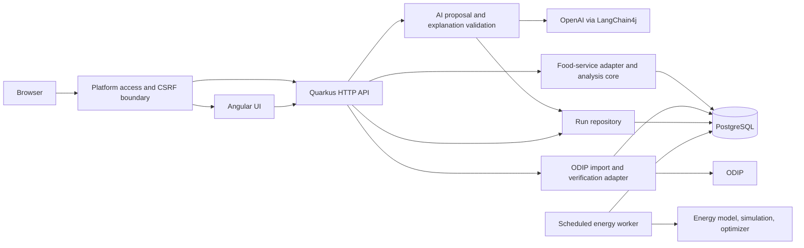
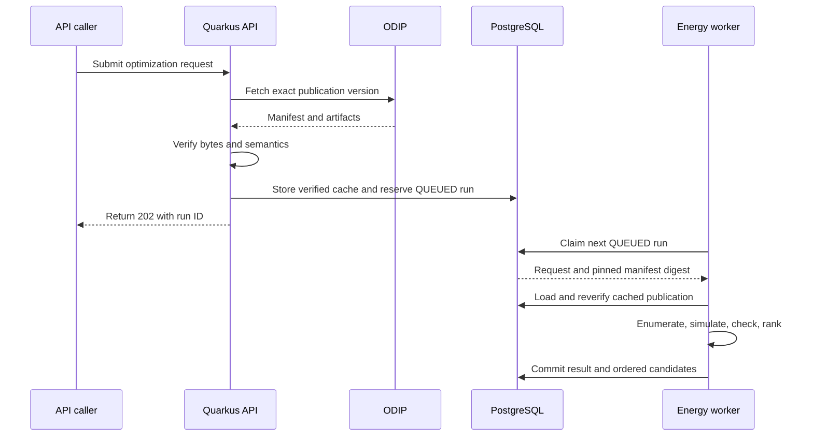
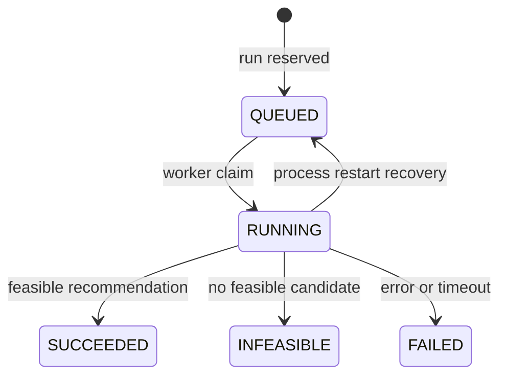

# Runtime Model

## Deployment and trust boundaries

The prototype is one public Quarkus service containing the Java API and built
Angular UI. Flyway migrates its managed PostgreSQL database at startup. The
deployment declares one service replica. ODIP is an external publication
service reached with managed reader credentials; its data is imported only
after version, digest, and semantic verification.

The hosting platform handles login, access policy, CSRF, and normalized
principal headers at the service boundary. The application validates the
principal header shape and uses the principal ID to scope energy runs. It
does not decide group or role membership.

## Execution paths

The food-service path is synchronous. At startup, the adapter validates the
fixture and saves its normalized population if absent. For an analysis
request, the repository reconstructs the population and the pure analysis
engine calculates the response. No analysis-result table is involved.

The energy path is durable and asynchronous:

1. The API validates the request and `Idempotency-Key`, imports or reuses the
   exact verified publication, estimates the search size, and reserves a run.
   The unique `(principal_id, idempotency_key)` pair reuses the same run for an
   identical canonical request and rejects a different request.
2. A scheduled worker polls every two seconds. It claims a `QUEUED` row with
   `FOR UPDATE SKIP LOCKED`, marks it `RUNNING`, and evaluates it on one
   computation executor. The deadline is 300 seconds.
3. The worker checks the cached publication against the accepted manifest
   digest, then writes the terminal result and candidate rows in one
   transaction. A claim UUID prevents a stale worker from overwriting a newer
   claim. At startup, interrupted `RUNNING` rows are requeued.

Feasible candidates are persisted first in rank order. Infeasible candidates
follow in configuration-ID order. Recovery assumes the declared single
replica. Terminal states are `SUCCEEDED`, `INFEASIBLE`, and `FAILED`.

The readiness resource requires the persisted food-service population and a
queryable energy run table. It does not depend on current ODIP availability.

AI assistance is synchronous and separate from the durable worker. A proposal
request sends the user's description to the model and validates the returned
proposal or clarification envelope. It does not reserve a run. The UI requires
explicit confirmation of the current structured request before calling the
normal run endpoint; edits clear that confirmation.

An explanation request first resolves a completed run owned by the caller.
VEF builds a bounded snapshot of customer inputs, assumptions, the saved result,
and the recommended candidate for success, then validates the model's categories,
JSON Pointer citations, exact values, and required result facts. Neither model
interface has tools. A provider failure or rejected explanation leaves the saved
deterministic result readable. See the [API model](api-model.md) and
[energy architecture](../energy-configuration.md) for limits and remaining
acceptance evidence.

Implementation references: [energy worker](../../../apps/prototype/api/src/main/java/de/eseidinger/variabilityengineering/energy/EnergyRunWorker.java),
[deployment declaration](../../../application.json).
