# Development Plan

Status: proposed sequence without confirmed dates.

The [energy configuration implementation plan](energy-configuration-implementation-plan.md)
tracks the accepted deterministic energy workflow and the AI assistance in
published contract kit 1.0.0. Gate 5 was accepted on October 17, 2026; the
bounded Gate 6 / VEF-05 is now [closed with limitations](https://github.com/eseidinger/energy-system-configuration/blob/main/reviews/2026-10-29-gate-6-closure.md).
VEF's consumer lock pins kit 1.0.0, and application v1.0.0 is ready in
production. AI proposals, confirmation and validated explanations are
implemented. The [verification record](energy-contract-kit-verification.md)
and [AI runbook](energy-ai-acceptance-runbook.md) retain the chronological AI
case evidence and the DEC-10/11/12 limits. The owner-reported production
optimization matches every supplied reference-oracle field.
The food-service analysis contract and energy numerical baseline are unchanged.

```mermaid
flowchart LR
    Semantics[Semantics and stack] --> Core[Evaluation core]
    Core --> App[Prototype application]
    App --> Deploy[First deployment]
    Deploy --> Interactive[Interactive analysis]
    Interactive --> Normalize[Normalized populations]
    Normalize --> Food[Food-service demonstration]
    Food --> Impact[Impact and configuration]
    Impact --> Optimize[Portfolio optimization]
    Optimize --> Framework[Framework components]
    Framework --> Experiments[Additional domains and experiments]
```



The prototype application is the first integrated deliverable. The implemented
synthetic food-service fixture establishes observed-population semantics. A future
generative fixture will establish configuration, constraint, and presence-condition
semantics. Framework components are created later from stable, verified contracts
rather than treated as prerequisites.

The observed-data path includes the synthetic food-service population, adapter,
analysis, impact, persistence, UI, and local image verification. The separate
energy path adds verified ODIP publications, bounded generation, hourly simulation,
exhaustive optimization, durable owned runs, and AI-assisted requests and
explanations. CI deployment and owner-confirmed production runs are recorded.
General-purpose generative evaluation and configuration completion,
hiding/combining dimensions, portfolio optimization, and complete deployed
regression/recovery evidence remain future work. The flow above is the target
dependency model; the energy slice has advanced independently of the broader
framework sequence.

## Proposed repository evolution

```text
apps/prototype/
  api/                   Independent backend project
    src/                 API and domain source
    tests/               Unit, contract, and persistence tests
  ui/                    Independent frontend project
    src/                 UI source and assets
    tests/               Component, interaction, and accessibility tests
  integration-tests/     Black-box UI/API/PostgreSQL checks
  deployment/            Single-image deployment assembly
docs/                    Product, architecture, decisions, development, operations
examples/                Synthetic models and later domain fixtures
adapters/                Later domain-specific dataset mappings
spec/                    Stable interchange and result contracts
compliance-tests/        Shared reference inputs and expected outputs
java/                    Later Java components
python/                  Later Python components
typescript/              Later TypeScript components
ui/angular/              Later Angular visualization components
ui/react/                Later React visualization components
experiments/             Reproducible algorithm and storage studies
```

Create only the directories required by current work. A future solver dependency belongs behind an optimization interface and is added only after an exhaustive fixture defines its semantics. Add implementation evidence and observed limitations as each milestone is completed.
